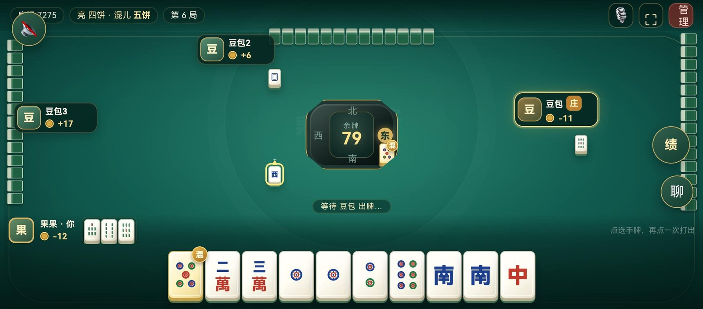

# 家规麻将 · 儿牌幺九麻将

> **素材与许可**：本仓库包含源代码与**一张项目自绘界面的运行截图**（[docs/screenshot.jpg](./docs/screenshot.jpg)），**不含任何音频、二维码或其他第三方素材**。运行时所需的音效与背景音乐需自行准备并确认授权，详见 [ASSETS.md](./ASSETS.md) 与 [NOTICE.md](./NOTICE.md)。
>
> **免责声明**：本项目为家庭娱乐用的**记分工具**。文中的「算钱 / 元」均为虚拟记分单位，不涉及任何真实货币、充值、提现、赌资或博彩行为。

一个基于 Node.js（Express + WebSocket）的 2–4 人联机麻将游戏，实现了一套自定义的「家规」玩法：儿牌万能、幺九开门、大胡翻倍。

## 运行截图



> 界面与牌面均由本项目代码绘制，截图为本地运行时的实机画面；图中玩家昵称为演示数据。仓库不包含任何音频或第三方游戏素材。

## 玩法规则

- **牌型**：万 / 饼 / 条 1–9 各 4 张 + 东南西北中发白各 4 张，共 136 张。
- **儿牌（万能牌）**：开局从牌墙移出并翻开一张「儿牌」，其余同点数同花色的牌全部成为万能牌，可以充当任意牌（但不能充当幺九）。
- **第四张变儿**：当某张牌的 4 张全归同一名玩家（手牌 + 亮牌）时，第 4 张自动变为万能牌。
- **胡牌条件**（需同时满足）：
  - 4 组（顺子/刻子）+ 1 对将牌；
  - 手牌或亮牌中**必须有真幺九**（1、9 或字牌）；
  - **必须开门**（至少有一次吃或碰）；
  - 万、饼、条**不缺门**；
  - 至少一个刻子（将对子为中发白时除外）。
- **大胡**：全刻子 + 一对，无顺子（不能有吃的亮牌）。
- **操作**：只有**吃**（限上家）和**碰**，没有杠。
- **穷胡**：手牌和亮牌中没有任何万能牌即为穷胡。

### 算钱规则（单位：元）

| 牌型 | 基础 | 穷胡 | 自摸 | 点炮 |
|------|------|------|------|------|
| 平胡 | 1 | ×2 | ×2 | 点炮者 ×2 |
| 大胡 | 15 | +5 | +5 | 点炮者 +5 |

庄家因素作用于每一笔支付：胡牌者是庄家 → 所有人支付翻倍；付钱者是庄家 → 该笔翻倍。

## 功能特性

- **账号系统**：注册 / 登录 / 自动登录，密码加盐 SHA-256 存储。
- **好友系统**：添加好友、好友申请、在线状态、查看好友所在房间。
- **房间系统**：4 位房间号，支持创建 / 加入 / 房内聊天 / 断线重连（rejoin）。
- **机器人**：支持添加 AI 玩家（LLM 决策 + 规则兜底），凑不够人也能开局。
- **战绩系统**：对局记录持久化保存（最近 5000 局），可查询历史战绩。

## 快速开始

```bash
# 安装依赖
npm install

# 启动服务（默认端口 3000）
npm start

# 自定义端口
PORT=8080 npm start
```

打开 `http://localhost:3000` 即可开始游戏。

## 机器人配置（可选）

机器人默认走**规则兜底**策略，无需任何配置即可使用。若想让 AI 走 LLM 决策，通过环境变量注入 API Key：

```bash
DEEPSEEK_API_KEY=你的key \
ARK_API_KEY=你的key \
ZHIPU_API_KEY=你的key \
npm start
```

| 机器人 | 模型 | 环境变量 |
|--------|------|----------|
| 蓝色大肥鱼 | deepseek-flash | `DEEPSEEK_API_KEY` |
| 豆包 | doubao-seed-2-1-pro | `ARK_API_KEY` |
| Z | glm-5.3-flashx | `ZHIPU_API_KEY` |

> ⚠️ 请勿将 API Key 写入代码提交到仓库。

## 部署（生产环境）

服务器上的部署方式（可参考）：

- **systemd** 守护进程：`/etc/systemd/system/mahjong.service`
- **Nginx** 反向代理 WebSocket：`/etc/nginx/sites-available/mahjong.conf`

```bash
# systemd 服务示例要点
[Service]
WorkingDirectory=/home/ubuntu/family-mahjong
ExecStart=/usr/bin/node server/index.js
Restart=always
```

## 项目结构

```
family-mahjong/
├── package.json          # 项目配置（npm start 启动）
├── docs/
│   └── screenshot.jpg    # 项目自绘界面的运行截图
├── public/               # 前端（原生 HTML/CSS/JS）
│   ├── index.html
│   ├── client.js
│   ├── style.css
│   └── music/, voice/   # 需自备，不随仓库分发
└── server/               # 后端
    ├── index.js          # 入口：HTTP + WebSocket 服务、房间/账号/好友逻辑
    └── game.js           # 麻将引擎：发牌、儿牌、胡牌判定、算钱
```

**运行时数据**（不入库，由服务端自动生成）：

- `server/accounts.json` — 用户账号数据
- `server/history.json` — 对局战绩


## 素材与许可

- 仓库内**不包含**任何 `.mp3` 音频、公众号二维码或第三方游戏素材；唯一的图片是 [docs/screenshot.jpg](./docs/screenshot.jpg)，为项目自绘界面的实机截图。首次运行无音频属正常现象，页面已内置静音与合成音兜底，不会报错。
- 需要音效时，请按 [ASSETS.md](./ASSETS.md) 的文件名与目录自行放置**你有合法授权的素材**。
- 代码许可与第三方依赖说明见 [LICENSE](./LICENSE) 和 [NOTICE.md](./NOTICE.md)。
- 本项目仅供学习与展示，请勿用于任何涉及真实资金结算的用途。
